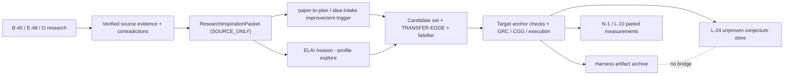

# Research-coupled creativity for ELAI and its planning tools (2026-07-12)

STATUS: DESIGN COMPLETE; BENCHMARK PREREGISTERED; NO IMPLEMENTATION AUTHORIZED.

This document is the local `spec-eval` + `idea-intake` + `planning-workflow` result for the question:
can ELAI couple creativity directly to its research system while preserving grounded reasoning, and how
should that capability be improved and benchmarked in both the runtime and the planning tools?

## Verdict up front

Yes, but the coupling must be one-way and typed:

`verified research -> source-scoped inspiration packet -> candidate generation -> independent target
grounding / execution`.

The research system supplies evidence and distant mechanisms. It does not supply truth about whether a
mechanism transfers to ELAI. A citation can prove what happened in the source domain; it cannot prove that
the proposed ELAI transfer is valid. Every transfer remains an unproven conjecture until its target-side
falsifier, grounding receipt, or execution check passes.

This is materially different from the refuted Frontier-Discrimination Loop (FDL): it has no
archive-conditioned generation cycles, no mutate/recombine/reframe rotation, no operator credit or fade
controller, no ProbeUtility scheduler, and no bridge between the harness archive and L-24 runtime memory.
It is a single research-supply step before a normal generation call, followed by the existing trust spine.

## 1. Goal, success condition, and boundaries

Goal: increase the number of non-redundant, useful mechanisms found by ELAI and by
`improvement-conjecture` without decreasing grounding quality or hiding the added cost.

The claim is earned only if a preregistered paired benchmark shows all of the following:

1. more unique execution-valid improving mechanisms are recovered than both direct generation and a
   strong verified-evidence control;
2. the best execution-measured value improves, rather than diversity rising through junk;
3. source/target grounding is non-inferior within the locked margin;
4. the advantage disappears or falls materially when packets are shuffled between tasks, showing that
   the transfer is task-specific rather than extra-token theater;
5. cost-normalized frontier yield is not materially worse.

Non-goals:

- no autonomous claim of discovery;
- no scalar "creativity score" fused from novelty, value, grounding, and cost;
- no LLM judge as a promotion gate;
- no raw research report or raw archive dump as the product interface;
- no training, RL, multi-cycle search, or self-improvement controller;
- no change to the proven-only code-fix/auditor path;
- no harness archive <-> L-24 or verified-case-graph bridge.

## 2. What ELAI already has

The missing object is a transfer boundary, not a new research engine.

- Phase 4D and B-40 already define `ResearchTree`, `ResearchNode`, `ResearchReport`, multi-root
  `FlashResearch`, domain research presets, alternatives, contradictions, evidence levels, and recursive
  Idea -> Concepts -> Phases -> Steps -> BabySteps research.
- E-48 already adds editable research plans, source-tiered retrieval, citation verification,
  SEARCH-producer attribution, and never-silently-resolved contradiction nodes.
- B-42 and O already define global Cosmos artifacts, scheduled research refresh, typed topic manifests,
  taint/replay, and bounded briefings.
- L already separates claims from evidence, routes risk into retrieval, measures semantic meaning clusters,
  supports explore-mode rival conjectures/falsifiers, and walls unproven conjectures away from proven fixes.
- N already defines the measurement spine, one ablation engine, novelty/ambiguity-to-budget wiring, and the
  exogenous-grounding floor.
- The harness `improvement-conjecture` tool already preserves target grounding, append-only status,
  unfused axes, and the narrowly supported `NOVEL-CREDIBLE` selector. Its rules explicitly allow ordinary
  exogenous injection while forbidding the refuted FDL mechanisms.

The present gap: research reaches framing and grounding mostly as a report or briefing. There is no typed,
source-scoped object that abstracts a verified mechanism into object mappings, shared relations,
invariants, disanalogies, and a falsifiable transfer hypothesis for a generation role.

## 3. External grounding

The design imports methods, not reported effect sizes. All promotion thresholds remain ELAI-measured.

| primary source | relevant result | ELAI import |
|---|---|---|
| [Shen, Druckmann, Zou 2026](https://arxiv.org/abs/2605.11258) | A two-step structure-mapping method extracts object mappings/shared relations, then searches the analogous domain. It beat no-domain and cross-domain baselines on diversity/novelty and implemented four candidate transfers. | Use typed relational mappings, equal-budget controls, and implementation/execution as the value check. Do not import its biomedical numbers as ELAI evidence. |
| [ResearchBench 2025](https://arxiv.org/abs/2503.21248) | Decomposes scientific discovery into inspiration retrieval, hypothesis composition, and ranking across 12 disciplines. | Measure research supply, transfer composition, and selection separately. |
| [HypoSpace 2025](https://arxiv.org/abs/2510.15614) | Treats generation as a set-valued task and measures Validity, Uniqueness, and Recovery in exactly enumerable spaces with deterministic validators. | Use an enumerable executable strategy space for the cheap creativity falsifier; correctness alone cannot hide mode collapse. |
| [Si et al. 2026](https://arxiv.org/abs/2601.14525) | Plausible ideas often fail after execution; execution-guided search can help, while reward optimization can collapse diversity and fail to improve the maximum. | Execution receipts outrank judges; no RL; report best value and coverage, not average score alone. |
| [Si, Yang, Hashimoto 2024](https://arxiv.org/abs/2409.04109) | Expert review found novelty/feasibility tension, self-evaluation failures, and weak diversity; the authors call for end-to-end execution studies. | Keep novelty and feasibility/value unfused; use blind judgments only as secondary diagnostics. |
| [Verbalized Sampling 2025](https://arxiv.org/abs/2510.01171) | Explicit distribution elicitation can reduce typicality-driven mode collapse. | Retain L-22's distribution proposal contract as a same-call baseline/rider, not a new controller. |
| [Literature-grounded novelty assessment 2025](https://arxiv.org/abs/2506.22026) | Retrieve-then-rerank over facets improves literature-grounded novelty assessment. | Novelty checking happens after generation and remains an assessment axis, never source evidence for transfer validity. |
| [Design fixation study 2024](https://arxiv.org/abs/2403.11164) | In a controlled visual ideation study, exposure to AI examples increased fixation and reduced idea variety/originality. | Keep full-report/example injection as an adversarial benchmark arm, not the default interface. |

## 4. Architecture comparison

### A. Inject the full `ResearchReport` / `AVAILABLE_COSMOS` briefing

Strength: maximum source context and easy implementation.

Failure mode: source prose becomes the prompt attractor, duplicates consume the context budget, examples
can fixate generation, and citations are easily misread as support for the target transfer. Raw full-report
injection is rejected from the promotion arms. `VERIFIED_EVIDENCE` is instead a bounded projection of the
same verified source mechanisms/facts/support edges plus the matched target scaffold, with raw excerpts removed.

### B. Generate first, research only to verify/repair

Strength: preserves the generator's unconstrained prior and is the safest grounding fallback.

Failure mode: research can correct or reject an idea but cannot introduce a mechanism the model never
sampled. Keep this as the baseline production path and an ablation; do not call it a creativity mechanism.

### C. Typed relational inspiration packets (selected)

Strength: supplies exogenous mechanisms while bounding prompt volume and making the source-vs-transfer
epistemic boundary machine-readable. It matches the structure-mapping mechanism that now has direct
external evidence and composes with ELAI's verified research types.

Risk: a packet can leak a target answer, encode a bad analogy, or merely add tokens/target deliberation. The
locked matched-scaffold and relation-shuffled arms, hidden executable tasks, per-source-predicate support
edges, source-only evidence scope, matched prompt envelopes, equal candidate cap, and cost accounting are
therefore binding.

### D. Shared research/conjecture memory with iterative controller

Rejected. This is the prior FDL/B-4 shape under a new name and violates the harness/runtime wall. Research
may feed a packet into one call; it may not become an archive-conditioned cycle controller.

## 5. The selected boundary

### 5.1 `ResearchInspirationPacket`

The packet is a provenance-bearing input artifact, not a verdict:

```text
ResearchInspirationPacket {
  packet_version
  packet_id                         # blake3 of canonical packet fields
  target_problem_id
  source_domain
  source_problem
  source_mechanism
  object_mappings[]                 # source object -> target role
  shared_relations[]                # id + source_predicate + proposed_target_predicate
  invariants[]                      # conditions required in both domains
  disanalogies[]                    # where the mapping may break
  transfer_hypothesis
  predicted_observation
  target_falsifier
  source_evidence_refs[]            # VerifiedCitation / Cosmos artifact handles
  source_support_edges[]            # source field/relation-source-predicate -> evidence ref
  contradiction_refs[]
  source_quality
  freshness
  evidence_scope = SOURCE_ONLY
  packetizer_id + version
}
```

Binding semantics:

- `source_evidence_refs` support only `source_mechanism` and the source-side predicate of a relation; every
  source mechanism claim and shared-relation source predicate has at least one `source_support_edge` to a
  resolving verified ref. The target-side predicate and the claim that a relation is shared stay unvalidated.
- `transfer_hypothesis`, `predicted_observation`, and `target_falsifier` start as unvalidated.
- the generator cannot mint or edit evidence refs, packet status, or packet id;
- raw source prose and raw conjecture/archive prose do not enter generation;
- contradictions are retained and referenced, not summarized away;
- an empty `disanalogies` list is allowed only with an explicit `none-found` marker, never silent omission;
- a candidate using the packet emits `TRANSFER-EDGE: <candidate> <- <packet_id>:<relation_ids>`;
- a candidate with no target-side falsifier fails the existing demarcation triage.

### 5.2 End-to-end composition



The last dotted edge is a wall, not a data flow.

### 5.3 Tool coupling

`paper-to-plan` and the improvement-trigger route in `idea-intake` may request packets after the tool
benchmark passes. The paper interface map or research report is converted into the source compartment;
the generator sees the bounded packet, never the raw paper plus archive. The normal app/feature intake
path remains unchanged until separately measured.

The surviving v1.1 tool stages remain:

1. one direct self-coordinating candidate call;
2. deterministic ledger/anchor/demarcation triage;
3. independent falsifier execution or cited estimate;
4. unfused axes plus a declared selector profile.

Q-10 adds only a typed optional input and a benchmark. It does not revive `--cycles`, `--discriminate`,
`probe`, operator rotation, or automatic plan authoring.

### 5.4 ELAI runtime coupling

After both tool gates pass, the Rust packet type may be built from `ResearchReport`,
`VerifiedCitation`, and Cosmos artifacts and exposed only to `/reason --profile explore` in observe-only
mode. Generated objects enter L-24 as ordinary unproven conjectures; the packet itself remains an input
receipt. Code-fix, auditor, critic, and verified-case paths cannot retrieve it.

Runtime activation requires the L-10 PS-3 arm to show more receipt-valid meaning-cluster coverage without
worsening hallucination delta or falling below N-16's exogenous-grounding floor. Until then, the runtime
consumer stays absent; a plan or type definition alone is not activation.

## 6. Benchmark ladder

The binding protocol lives in
`workflow/reasoning/research-coupled-creativity-preregistration-2026-07-12.md`.

### B-CREATIVITY-0 — cheapest mechanism falsifier

- K=30 paired hidden executable tasks over an exactly enumerable strategy space.
- Five arms: `DIRECT`, `MATCHED_SCAFFOLD`, `VERIFIED_EVIDENCE`, `RELATIONAL_PACKET`,
  `SHUFFLED_PACKET`.
- Same model, task, candidate cap, generation-token cap, parser, executor, and seeded arm order.
- Primary endpoints: execution-valid improving-strategy Recovery and best execution delta.
- Validity, Uniqueness, grounding, source specificity, cost, and token use are reported separately.

This tests whether relational research conditioning works at all. It does not prove ELAI usefulness.

### B-CREATIVITY-1 — planning-tool value

- K=30 paired ELAI improvement fixtures with live target anchors and hidden deterministic micro-executors.
- Same five arms and frozen packet/source manifests.
- Primary endpoints: execution-validated non-redundant mechanism yield and best target-side measured value.
- Blind plan quality / literature novelty panels are secondary only.

Only a win here permits skill/tool adoption.

### B-CREATIVITY-2 — ELAI explore/grounding value

- Observe-only L-10 arm after B-CREATIVITY-0 and -1 are supported.
- Compare normal explore against research-conditioned explore on the same tasks/budgets.
- Primary creativity endpoint: unique meaning clusters that carry a target grounding receipt and an
  executable falsifier.
- Binding safety endpoint: PS-3 hallucination delta non-inferiority and N-16 exogenous-grounding floor.

Only a win here permits a production explore consumer. A synthetic/tool win cannot authorize runtime.

## 7. Idea-intake decomposition

This is the local, user-authorized replacement for the skill's normal agent chain. Each leaf is small enough
for one implementation session and carries its own negative arm.

### C1 — Measurement contract

#### C1.P1 — Freeze the falsifier

- C1.P1.S1: implement packet schema validation and canonical blake3 identity.
  - B1: reject generator-authored evidence refs, missing/dangling source-predicate support edges, blended
    source/target relation claims, and non-`SOURCE_ONLY` packets.
  - B2: property-test field-order invariance and unknown-field fail-closed behavior.
- C1.P1.S2: build the frozen K=30 executable transfer corpus.
  - B1: freeze source pools before hidden task instances are generated.
  - B2: prove the packet builder never sees hidden executor outcomes.
- C1.P1.S3: implement the five-arm paired runner and manifest hashing.
  - B1: randomize arm order by a recorded seed; keep arm labels out of generator prompts.
  - B2: fail on any source/scaffold/packet/task hash drift or unmatched preprocessing/token envelope.

#### C1.P2 — Make creativity falsifiable

- C1.P2.S1: compute Validity, Uniqueness, Recovery, best execution delta, and frontier yield independently.
  - B1: enumerate the full admissible strategy space off-agent.
  - B2: keep raw diversity and execution-valid diversity in separate columns.
- C1.P2.S2: implement paired confidence intervals and non-inferiority checks.
  - B1: lock the bootstrap seed/sample count before the first evidence run.
  - B2: no post-run threshold edits; a changed protocol gets a new preregistration version.
- C1.P2.S3: run packet specificity and leakage controls.
  - B1: shuffled-packet arm.
  - B2: source lexical-overlap diagnostic and hidden-answer scan.

### C2 — Planning-tool coupling

#### C2.P1 — Build the source-scoped tool boundary

- C2.P1.S1: add a packet validator/renderer shared by the benchmark and skill.
- C2.P1.S2: extend candidate artifacts with `TRANSFER-EDGE` while retaining exactly one `BIRTH-EDGE`.
- C2.P1.S3: extend deterministic triage to verify packet ids, evidence scope, relation refs, and target
  falsifiers; a packet never becomes a hard correctness verdict.

#### C2.P2 — Measure real tool value

- C2.P2.S1: author K=30 live-anchor fixtures with closed micro-executor kinds.
- C2.P2.S2: run the same five arms and freeze all call/receipt artifacts.
- C2.P2.S3: classify SUPPORTED / NULL / REFUTED using the preregistered joint gate.

#### C2.P3 — Adopt only on support

- C2.P3.S1: update `improvement-conjecture` to accept one optional packet set.
- C2.P3.S2: route paper-to-plan Phase 4 and idea-intake improvement Step 1.5 through the supported packet
  path; normal feature intake remains control.
- C2.P3.S3: restore Claude/Codex skill parity from one versioned contract and add positive/negative evals.

### C3 — ELAI research-to-explore coupling

#### C3.P1 — Rust packet boundary

- C3.P1.S1: define `ResearchInspirationPacket` as a closed serde type with bounded fields.
- C3.P1.S2: build it only from verified research rows/Cosmos artifacts while preserving contradictions.
- C3.P1.S3: journal/hash packet construction and consumption; the model cannot construct trusted fields.

#### C3.P2 — Observe-only runtime bench

- C3.P2.S1: add normal, matched-scaffold, verified-evidence, relational, and relation-shuffled arms to the
  L-10/N-1 measurement spine under identical observe-only budgets.
- C3.P2.S2: inject packets only into L-23 explore and persist generated conjectures through L-24's normal
  unproven path.
- C3.P2.S3: compute receipt-valid meaning-cluster coverage, PS-3 hallucination delta, exogenous-anchor ratio,
  and cost from the journal.

#### C3.P3 — Conditional activation

- C3.P3.S1: activate the explore consumer only on a B-CREATIVITY-2 SUPPORTED row.
- C3.P3.S2: keep code-fix/auditor/verified-case retrieval physically unable to read packets.
- C3.P3.S3: surface the unfused creativity/grounding/value/cost report and D-15 honesty label; never an
  autonomous "discovery" badge.

### C4 — Governance and regression resistance

#### C4.P1 — Prevent epistemic laundering

- C4.P1.S1: render source evidence and target transfer receipts in separate report sections.
- C4.P1.S2: seeded test: a valid source citation plus a false target transfer must fail target grounding.
- C4.P1.S3: seeded test: a contradiction referenced by a packet remains visible after generation.

#### C4.P2 — Keep the mechanism removable

- C4.P2.S1: register B-CREATIVITY results in N-1 as journal-recomputable measurements.
- C4.P2.S2: run N-9 drop-one ablations for generic target scaffold vs evidence vs relational mapping vs
  relation-shuffled mapping.
- C4.P2.S3: if the measured advantage disappears on a later standing-goal check, quarantine the consumer;
  never self-repair or silently change the packetizer.

## 8. Planning-workflow execution shape

No phase exceeds three deliverables or five files. Unit tests and operational tests are distinct.

| phase | deliverables | principal files | gate |
|---|---|---|---|
| T0 instrument | packet schema/validator; K=30 corpus + five-arm runner; independent artifact verifier | `.claude/tools/research_inspiration_packet.py`, `.claude/tools/conjecture_research_coupling_ab.py`, `.claude/tools/research_creativity_artifact_check.py`, one fixture file, one consolidated test file | schema/property tests + model-free `--preflight-only` + frozen `--prepare-only` + `--preflight-frozen` full enumeration |
| T1 tool evidence | frozen prereg manifest; K=30 full run; report | benchmark artifact directory only | B-CREATIVITY-0 joint gate |
| T2 live tool | live-anchor fixture pack; micro-executor adapter; full paired report | at most two tool modules, one fixture pack, two tests | B-CREATIVITY-1 joint gate |
| T3 tool adoption | canonical skill changes; paper/idea routes; harness parity/evals | split Claude and Codex mirrors into separate <=5-file slices | only after T1+T2 SUPPORTED |
| R0 runtime type | Rust packet type; research builder; contract tests | new packet module, research module export, up to three tests | source-only/type/contradiction properties |
| R1 observe-only | L-10 arm; N-1/N-9 recompute; runtime report | CLI bench arm, measurement adapter, tests | B-CREATIVITY-2 joint gate |
| R2 conditional consumer | L-23 explore input; L-24 normal persistence; human render | explore path, lane-wall contract, render/CLI path, tests | real trigger + negative code-fix/auditor read denial |

Operational verification must include a real model run for each evidence stage. Unit tests may mock packet
contents and bridge responses; they cannot satisfy a benchmark or runtime activation gate.

## 9. Adversarial self-audit

| attack | why it could fool us | binding patch |
|---|---|---|
| The packet contains the answer. | Synthetic transfer becomes supervised hinting. | Freeze source evidence/packets before hidden task instances; packet builder cannot call the executor; scan for target DSL/hidden ids; shuffled arm. |
| Extra reasoning/tokens cause the lift. | Treatment gets an extra target-decomposition call or more useful context, not research-conditioned relations. | `MATCHED_SCAFFOLD` gets a source-blind target scaffold from the same packetizer model/call/token budget; `VERIFIED_EVIDENCE` gets that scaffold plus the same source facts/support edges; non-target input envelopes are matched within the locked tolerance; report preprocessing/retrieval/generation cost separately. |
| A citation launders the target claim. | Source faithfulness is mistaken for transfer validity. | `evidence_scope=SOURCE_ONLY`; separate target receipt; false-transfer seeded test. |
| This is FDL renamed. | Archive feedback reappears through research. | One packet stage, one generation call, no archive prose/cycles/operators/credit/fade, no harness-runtime bridge. |
| Diversity rises through junk. | More signatures but no value. | Primary Recovery counts only execution-valid improving strategies; best execution delta is co-primary. |
| An LLM judge manufactures novelty. | Semantic scores become circular truth. | Exact signatures and executors are primary in B0; target receipts in B1/B2; judges/humans secondary and blinded. |
| Packet choice is cherry-picked. | Hand-selected analogies make the treatment win. | Frozen source pool, deterministic selection, packet hash manifest, shuffled-packet specificity gate. |
| Grounding suppresses exploration. | Strict evidence filter kills all distant ideas. | Source evidence and target falsifier are separate; an idea may remain pending, but cannot be promoted until target evidence exists. Report pending coverage separately. |
| Runtime contaminates trusted work. | Unproven research leaks into fixes/audits. | L-23 explore-only consumer; L-24 lane wall; explicit negative retrieval tests; no verified-case admission. |
| A synthetic win is overgeneralized. | The DSL is easier than ELAI. | Three gates: synthetic -> live tool -> runtime. Each downstream phase is forbidden until its predecessor is supported. |

Self-audit verdict: PASS WITH CONDITIONALITY. The mechanism is sufficiently different to justify a new
preregistration and plan, but no claim of improved ELAI creativity is yet earned. The cheapest falsifier is
the next action.

## 10. Implementation-readiness note (separate from the design verdict)

Current code inspection on 2026-07-12 found `ResearchReport`, `ResearchTree`, Cosmos briefing,
`VerifiedCitation`, E-48 research modules, D-15 novelty labels, and the I-27 convergence bench in the live
checkout. L-23/L-24 runtime explore/conjecture-memory symbols were not found in the inspected Rust paths,
so the runtime consumer is plan-dependent and must remain conditional. The harness v1.1 and executable
strategy bench exist. The Codex `.agents` tree lacks an `improvement-conjecture` mirror and its
paper-to-plan/idea-intake copies diverge from the Claude canonical copies; parity is a measured adoption
slice, not a reason to alter the mechanism verdict.

## 11. Final decision record

1. Directly couple creativity to research through `ResearchInspirationPacket`, not raw shared memory.
2. Keep source evidence and target transfer truth structurally separate.
3. Import structure mapping (objects + shared relations + disanalogies), not the paper's effect size.
4. Preregister five arms, including a source-blind matched-scaffold control and a schema-valid
   relation-shuffled negative control.
5. Require execution-valid Recovery and best value to improve together.
6. Gate tool adoption, then runtime observe-only, then runtime activation as three separate decisions.
7. Preserve every prior FDL/ProbeUtility rejection and the harness/runtime archive wall.

End of research-coupled-creativity-design-2026-07-12.md.
